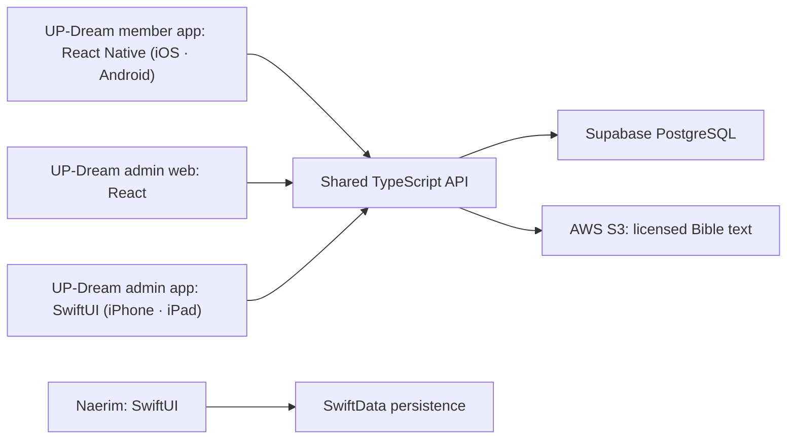

# Yi Suheon · 이수헌 · イ・スホン

Software engineer who plans, builds, ships, and operates mobile apps and the backend behind them.

I independently built **UP-Dream**, a church youth-group service used every week: a member app on the **App Store and Google Play**, a **web admin console**, a **native iOS admin app**, and the **shared TypeScript API** they all depend on. I also built and released **Naerim**, a native SwiftUI coffee-brewing log. Japanese is my second native language, and I am looking for software engineering roles in Japan.

[Portfolio](https://yisuheon.dev) · [App Store](https://apps.apple.com/us/developer/suheon-yi/id6797694037) · [Google Play](https://play.google.com/store/apps/details?id=kr.or.gimhaejeil.youth) · [Email](mailto:suheon777@icloud.com)

### 日本語のプロフィール

モバイルアプリと、それを支えるバックエンドを企画から運用まで一人で手がけるソフトウェアエンジニアのイ・スホン（이수헌）です。教会の青年部向けサービス「UP-Dream」では、会員アプリ（App Store・Google Play）、管理者Web、ネイティブiOS管理者アプリ、そして共通のTypeScript APIを開発し、毎週の活動で実際に使われています。コーヒー記録アプリ「Naerim」もSwiftUIで開発・公開しました。2001年から2014年まで日本で暮らし、日本語はネイティブレベル（JLPT N1）です。東京都市大学への1年間の交換留学を経て、日本でエンジニアとして働くことを目指しています。

## At a glance

| | |
| --- | --- |
| **Shipped** | 3 App Store apps · 1 Google Play app · 1 web admin console |
| **In real use** | 41 of 61 regular attendees use UP-Dream (67.2%) · 56 of 114 attendees overall (49.1%) · Dec 2025 – Nov 2026 |
| **Scope** | Planning, design, development, store release, policies, and day-to-day operation — on my own |
| **Languages** | Korean (native) · Japanese (native level, JLPT N1) · English (technical reading, business email) |

Usage counts people who attended at least once across 48 Sunday youth services (1 Dec 2025 – 3 Nov 2026), checked against completed sign-ups. "Regular" = attended 24 or more of the 48. Attendance comes from records saved in the app; unrecorded weeks are not counted as absences. Pastors and test accounts are excluded.

## UP-Dream — one service, four surfaces

UP-Dream replaced a split setup — room bookings on a shared Naver calendar, communication in a KakaoTalk open chat — with one service for announcements, schedules, room reservations, attendance, prayer requests, and Bible reading.

| Surface | Platform | Who uses it, and when | Stack | Explore |
| --- | --- | --- | --- | --- |
| **Member app** | iOS · Android | Every member, through the week | TypeScript · React Native · Expo | [Overview](docs/updream.md#member-app) · [App Store](https://apps.apple.com/kr/app/id6797694035) · [Google Play](https://play.google.com/store/apps/details?id=kr.or.gimhaejeil.youth) |
| **Admin web** | Browser | Staff at a desk: approvals, member records, account merges | TypeScript · React | [Overview](docs/updream.md#admin-web) |
| **Admin app** | iPhone · iPad | Leaders on site, e.g. Sunday attendance | Swift · SwiftUI | [Overview](docs/updream.md#administrator-app) · [App Store](https://apps.apple.com/kr/app/id6810673532) |
| **Shared API** | AWS ECS Fargate | Behind all three clients | TypeScript · Supabase PostgreSQL · S3 | [Architecture](docs/updream.md#system-structure) |

Management work is split by situation, not duplicated: heavy desk work lives on the web, quick on-site work lives in the native app, and **every permission decision is made once, on the server**. The admin web uses two-step verification; the admin app requires Face ID or Touch ID.

Around the apps I also run the [service website](https://updream.church), its terms, privacy and child-safety policies, an in-app account-deletion flow, and the copyright permission for the Korean Bible text.

## Naerim · 내림

A native iPhone and iPad app for recording brewing conditions and comparing one cup with the next. Swift · SwiftUI · SwiftData · WidgetKit, localized in Korean, English, and Japanese. [Technical overview](docs/naerim.md) · [App Store](https://apps.apple.com/kr/app/id6808134502)

## How I work with AI

I use Claude Code and Codex as implementation tools, and I keep the decisions. Every AI-assisted change follows the same steps:

1. **Define the requirement myself** — from beta feedback and operating needs.
2. **Set the scope** — which screens may change, and what must not be touched.
3. **Delegate the implementation** — scoped frontend work and integration.
4. **Verify** — against data and permission rules, with regression tests and CI.
5. **Record where the AI was wrong**, and fix it myself.
6. **Keep the hard parts** — identity, permissions, concurrency, and release scope stay with me.

**Example — account merging in the admin web.** The same member had signed in with two different OAuth providers, and their roster record already held attendance history. The AI-generated merge treated the OAuth account as the unit and moved data from one account to the other. But attendance belongs to the roster record, not the login account, so the merge failed and attendance stayed attached to the wrong account. I rebuilt it around the **roster record as the single identity**, with each OAuth account merged in as a login method; attendance never has to move. Since then, I edit and review account and permission code myself. [Full case](docs/updream.md#ai-case-account-merge)

## Try the apps

Install each app, choose **데모 계정으로 로그인** (Sign in with a demo account) on the sign-in screen, and use the matching credentials.

| App | Demo ID | Demo password | Start here |
| --- | --- | --- | --- |
| [UP-Dream](https://apps.apple.com/kr/app/id6797694035) | `updream.app.review` | `ZYQw0tEyqiWOTSZ80k1gwDsXyTVSLaux` | Home screen, gratitude entries, and reflection history. [Demo guide](https://yisuheon.dev/en/projects/updream/#demo) |
| [UP-Dream Admin](https://apps.apple.com/kr/app/id6810673532) | `updream.admin.review` | `iSClZj1ZKzt5DKBDqmQsLN6lbIBFh3Vu` | Operations overview, member directory, and attendance. [Demo guide](https://yisuheon.dev/en/projects/updream-admin/#demo) |

The demo uses shared sample data that other visitors may change. Please do not enter real names, contact details, private prayer requests, or other personal information.

[한국어 안내](https://yisuheon.dev/ko/projects/updream/#demo) · [日本語の案内](https://yisuheon.dev/ja/projects/updream/#demo) · [English instructions](https://yisuheon.dev/en/projects/updream/#demo)

## Selected implementation

**[Recipe quantity validation in Swift](https://github.com/suheon927/naerim-recipe-validation)** — a standalone example adapted from Naerim. It checks numeric boundaries and scales a pouring plan while preserving the original draft when validation fails.

[Read the code](https://github.com/suheon927/naerim-recipe-validation/tree/main/Sources) · [Read the tests](https://github.com/suheon927/naerim-recipe-validation/tree/main/Tests) · [Run it locally](https://github.com/suheon927/naerim-recipe-validation#run-the-tests)

## Architecture

- **[UP-Dream: member app, admin web, admin app, and shared backend](docs/updream.md)** — system boundaries, authorization, concurrency, the Android release, and dated test results.
- **[Naerim: a native brewing workflow](docs/naerim.md)** — value types and persistence, immutable recipe snapshots, and session recovery.

## Technologies in context

| Language / area | Technologies | Where I used them |
| --- | --- | --- |
| **Swift** | SwiftUI, Observation, SwiftData, WidgetKit, App Intents | Naerim; UP-Dream admin app; Expo native modules in the member app |
| **TypeScript** | React Native, Expo, Expo Router | UP-Dream member app on iOS and Android |
| **TypeScript / SQL** | React, Node.js, vinext/Vite, Supabase PostgreSQL | UP-Dream admin web and shared API |
| **Infrastructure & verification** | AWS ECS Fargate, S3, GitHub Actions, Jest, XCTest | UP-Dream deployment and CI; native regression tests |
| **Java** | Spring Boot, JPA, MySQL | Stack Snapshot team backend |
| **Python** | Django | Gyeongju hackathon team backend |

**Earlier learning projects:** [Java / Android](https://github.com/suheon927/AndroidStudioProjects), [C](https://github.com/suheon927/MiniGames), and [Python / perceptrons](https://github.com/suheon927/PerceptronPractice).

## Team projects

### Stack Snapshot · backend contributor

Built the **QR generation and photo-download functionality** for a six-person team's event photo-booth service. The team used Java, Spring Boot, JPA, and MySQL, with Swagger and Nginx in the service stack.

[Repository](https://github.com/mjgwon24/stack-snapshot-back) · [My QR/download implementation](https://github.com/mjgwon24/stack-snapshot-back/commit/88965a2bbc6e419ca10b7fc5641d73bf693046c4)

### Gyeongju Regional Problem-Solving Hackathon · 2024

Backend developer in **Team Null**, which received **2nd place overall**. The tourism experience service combined reservations with photo-layer collection and composition. I worked on the Python/Django backend.

[Repository](https://github.com/Dongguk-Developer/2024hackathon_null) · [Award certificate](https://ibb.co/svXCRMYp)

## Education & international experience

- **Dongguk University WISE** — Computer Engineering, graduating March 2027.
- **Tokyo City University** — one-year exchange in the Faculty of Information Technology (April 2025 – March 2026).
- **Lived in Japan, 2001–2014** — Japanese at native level; JLPT N1 (December 2023).
- **StackUp, 2nd cohort · 2023** — collaborative learning and programming practice.

[Study archive](https://suheon927.notion.site/11573099573e8045bec2c186c84ba43d?pvs=4) · [Personal portfolio](https://yisuheon.dev)
